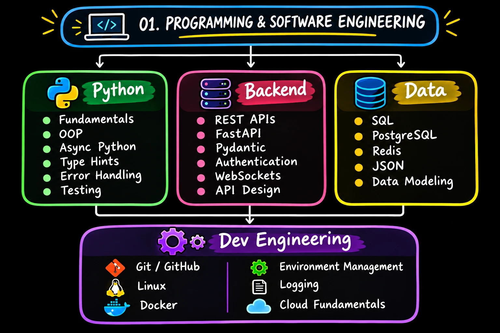

# 01. Programming and Software Engineering



Three tracks (Python, Backend, Data) that feed into dev engineering.

## Python
Fundamentals, OOP, async Python, type hints, error handling, testing.

## Backend
REST APIs, FastAPI, Pydantic, authentication, WebSockets, API design.

## Data
SQL, PostgreSQL, Redis, JSON, data modeling.

## Dev engineering
Git/GitHub, Linux, Docker, environment management, logging, cloud fundamentals.

## Progress

- [x] Python fundamentals: [revision guide (PDF)](python/python_fundamentals_revision.pdf)
- [ ] Backend with FastAPI
- [ ] Data: SQL, PostgreSQL, Redis
- [ ] Dev engineering: Git, Docker, Linux, cloud basics
- [ ] Module project: a production-style AI backend

## Contents

```
Fundamentals/
├── README.md
├── roadmap-overview.png
└── python/
    └── python_fundamentals_revision.pdf
```
